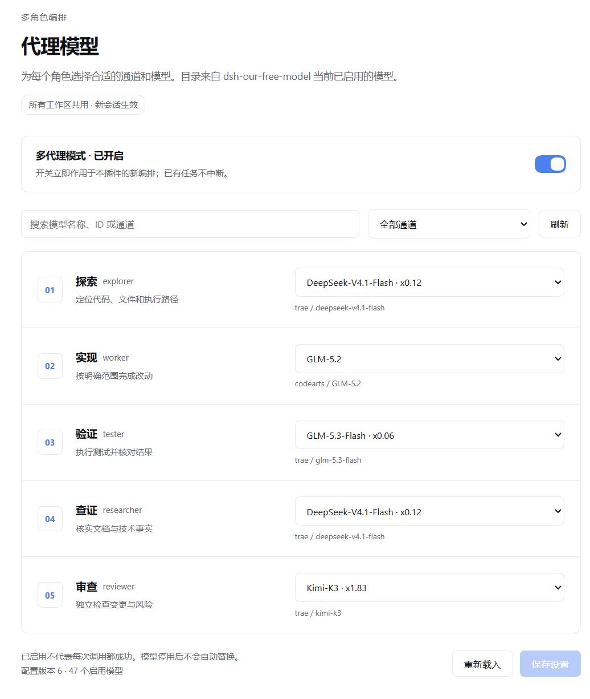

# DSH 代理模型



本插件为 DeepSeek Harness 的七个代理角色分别选择模型：候选目录来自宿主 `llm` 模型服务当前注册并广告的全部通道，包括 DSH 自带的 DeepSeek 通道、`dsh-our-free-model` 的免费通道，以及你自行配置的任意 provider。把不同角色绑定到不同模型后，分阶段任务会按角色使用对应模型。

插件不内置 provider 白名单，也不修改主会话模型。若同时安装 `dsh-our-free-model`，可以按其免费额度与模型能力安排角色；免费额度与使用条款仍由各供应商决定，部分通道可能不免费，同一供应商或账号下的多个模型也可能共享额度。插件不查询余额、不按剩余额度调度，也不会在额度耗尽时自动切换模型。

## 与其他模型路由插件的区别

本插件的定位是 **七角色各自绑定模型并做分阶段交接**，具体提供：

- **七角色分别映射**：探索、查证、实现、测试、审查、识图、文书可各自选择模型，允许多个角色使用同一模型。
- **覆盖宿主全部可用模型**：目录来自宿主 `llm.listProviders()` / `llm.listModels(provider)`，不限制特定插件或固定 provider 清单；通道停用、模型下架或适配器未注册后不再出现在目录中。
- **跨工作区共享设置**：在统一配置页面维护角色模型映射，无需为每个工作区重复配置。
- **新旧会话保留各自映射**：保存后新建的主会话采用新映射，已有会话继续使用原映射，不随新设置切换。
- **分阶段交接**：探索、查证、实现、测试、审查、识图、文书通过角色相关摘要和完整报告路径交接，后续角色可以回查原件。
- **识图角色与自动触发**：主会话模型无多模态能力时，可由根代理在调用 `agent_orchestrate` 时传 `capabilities:["vision"]` 或非空 `visionInputs`，编排自动在 plan 前插入 `vision` 阶段，派给 `visioner` 角色绑定的模型；也可显式 `plan:["vision",...]`。识图阶段只读图片、不改文件，结果作为证据供后续 explore/research/implement 引用。

例如，可以把探索与查证绑定到轻量快速模型，把实现绑定到编码能力更强的模型，把审查绑定到另一家通道以避免同源盲点；同时安装 `dsh-our-free-model` 时，也可以优先让有免费额度的通道承担部分角色。具体分配由用户决定；插件不查询余额、不按剩余额度自动调度，也不会在额度耗尽后自动切换模型，不承诺无限免费、零费用或具体节省金额。可选项来自宿主当前注册通道的广告清单，按适配器返回结果展开显示。

左侧导航提供“代理模型”页面，模型列表支持搜索和通道分组。配置对所有工作区共用，保存后创建的新主会话采用新映射，已有会话和任务保持原映射。

## 使用

1. 打开左侧“代理模型”。每次进入页面、窗口恢复焦点时，插件重新读取宿主当前注册的全部模型目录。
2. 为 explorer、worker、tester、researcher、reviewer、visioner、scribe 自由选择模型，点击“保存设置”。目录中不存在的旧选择会保留并提示不可用，不自动回退；visioner 建议绑定声明图片输入能力的模型，页面会在适配器明确声明仅文本输入时提示风险。
3. 开启顶部“多代理模式”。开关默认关闭，对后续编排调用立即生效；关闭不取消已在运行的任务。
4. 新建主会话，使用 `agent_role_models` 检查映射。单步有界任务使用 `agent_delegate`，多阶段任务使用 `agent_orchestrate`；探索之后由根决定方案，再携带返回的 `handoff` 作为 `prior` 继续实现/验证/审查。小任务仍可由根完成；不为凑数量拆成三个 worker。

开关控制本插件的执行入口，不修改 DSH 自带 Agent Teams 或其他插件的代理功能。主会话模型由原来的会话控件设置，插件不更改它。

## 识图触发与边界

当主会话模型（如 GLM-5.2）无多模态能力时，识图通过 `visioner` 角色完成：根代理调用 `agent_orchestrate` 时传 `capabilities:["vision"]` 或非空 `visionInputs`（图片路径/URL/说明），编排自动在 plan 前插入 `vision` 阶段，派给 `visioner` 绑定的模型。也可显式 `plan:["vision",...]`。

边界：编排工具只能由主会话代理显式调用，插件层无法在主会话收到图片时自动改路。即“主模型无视觉 → 自动派给视觉子代理”需要根代理主动调用编排并声明需要视觉；宿主级的“收到图片就自动改路”不在本插件能力范围内。`visioner` 应绑定具备视觉能力的模型，否则识图阶段会失败。

## 分层交接与委派

`agent_delegation_route` 根据 `scopeCount`、`risk`、`taskKind`、`bounded`、`effort`、`complexity`、`explicitRequest` 和 `needsIndependentCheck` 判断是否适合委派。明确且有一定工作量的单范围任务也可委派；很小的任务、模糊要求、高风险决策与 complexity=complex 的任务由根（Manager）处理。多个范围不自动授权并行。显式调用 `agent_delegate` 或 `agent_orchestrate` 可直接确认执行范围，后者兼容未传 `delegation` 的旧调用；根直接执行写入或命令前仍需评估。

完整输入和各阶段报告保存到 `~/.dsh/agent-model-router/handoffs/<运行目录>/`。visioner 最先执行且不接收其他阶段证据，worker 接收识图/探索/查证，tester 接收实现，reviewer 接收实现/测试。summary、evidence、commands 超过 1600 字符时节选，并附完整 JSON 的 source.path/pointer；约束、根方案、错误、未决问题和结构化发现不截断。下一角色必须按索引回查完整报告和实际文件，缺少证据时返回 blocked，不能补猜。

实现必须有 `prior.rootPlan`，否则返回 needs_decision，不启动 worker。探索后由根确认方案，再携完整 handoff 继续调用。失败、取消、归档失败阻止后续阶段；报告无自动删除，按需人工清理。

多阶段调用的 `result.runs` 提供各阶段 runId，顶层 runId 为最后记录阶段，agentsStarted 为总数；`result.handoff` 返回角色相关节选和源索引，`result.reportFiles` 给出完整原件路径。本机制不承诺具体 token 或缓存改善。

`result.metrics` 逐阶段记录路由档位（角色）、实际执行的 `provider/model`、runId、验收 verdict、该阶段真实失败计数与是否已触发升级；`result.warnings` 汇总护栏提示（如 reviewer 与 worker 同属一个模型家族时的跨家族审查建议）。阶段真实失败时 `result.recovery.escalateToManager=true` 并附带建议（重新拆解、换更强模型或换 lane），插件不自动替换模型；API 超时、限流等基础设施抖动不算真实失败、不触发升级。

`agent_delegate` 用于单步、有明确边界的委派：必须指定角色和任务；委派 `worker` 时必须列出精确 `files`，委派 `tester` 时必须列出完整 `commands`，测试代理按原样执行这些命令。根代理调用该工具即确认这份执行边界。它不用于下放模糊实现要求、高风险决策或方案选择；这些由根代理明确方案后再委派。

多代理模式开启时，优先直接调用 `agent_delegate` / `agent_orchestrate`。旧版宿主的前台 `subagent` / `subagent_fork` 调用仍由插件接管，并根据描述匹配角色。DSH 0.2.1-rc.2 的原生委派采用异步 `activation/subagentId`：插件会在启动任务前返回转调指引，由根代理立即改用 `agent_delegate`，保留任务与约束；不会伪造子代理 ID。无法确认的原生输出契约同样在启动前拒绝。无法判断角色时，或实现任务没有明确文件归属时，须用 `agent_delegate` 明确角色和范围。插件模式关闭时，插件停止接管普通委派，宿主原生委派工具仍可用；插件自己的 `agent_orchestrate` 与 `agent_delegate` 入口则保持关闭。用户明确要求原生语义时，根代理可先通过 `agent_delegation_route` 记录 `useNativeTool:true`：豁免自记录起 10 分钟内最多覆盖 32 次原生委派调用（足以覆盖一次并行扇出），这些调用交回宿主处理；超出上限或过期后回落为正常拦截。显式指定 `provider`/`model` 的原生调用超出角色映射的表达能力（插件委派只能按已保存映射路由），拦截信息会直接指引该豁免路径而不是 `agent_delegate`。

描述无法判断角色的原生委派会被拒绝，且拒绝信息直接给出可照抄的调用方式：七角色清单（`explorer` 探索/检索/读代码、`worker` 按 files 实现、`tester` 按 commands 验证、`researcher` 查证/文档、`reviewer` 审查、`visioner` 识图、`scribe` 文书/格式化/整理）、`agent_delegate({role:"explorer",task:"..."})` 单步示例与 `agent_orchestrate({task:"...",plan:["explore"]})` 多阶段示例，并提示以相同参数重试原生 `subagent` 会继续失败。描述含「探测/探活/排查/巡检/盘点/梳理」等字样的探测类任务会归入 `explorer`；含「整理/格式化/文案/文书」等字样的任务归入 `scribe`。多代理模式开启时直接调用 `workflow` 也会被拦截，拦截信息同样给出 `agent_orchestrate` 的最小调用示例。探索或排查类请求预计涉及多文件检索时，根代理应先 `agent_delegation_route(taskKind:'exploration')` 评估，再按结果选用 `agent_delegate(role:'explorer')` 或 `agent_orchestrate(plan:['explore'])`；只查看一两个文件的小探索由根直接完成。

插件模式开启时，根代理直接写文件或运行有副作用的 shell 命令前须调用 `agent_delegation_route` 评估；`route=root` 的评估按任务在同一工作区内复用（15 分钟或 50 次上限，先到者失效），工作区变更后需重新评估，因此同一任务内的连续命令无需逐条评估。只读检查类命令（如 `git status`、`git diff`、`Get-ChildItem`、`Test-Path`、`--version` 查询）不需要评估；含管道、重定向、命令串联或用途不明的命令仍按有副作用处理。评估结果为 `delegate` 时根不获得直接执行授权，应改用 `agent_delegate` 委派该有界任务。子代理不得嵌套编排或继续委派。除 `worker` 的获准文件写入外，子代理采用宿主确认的只读沙箱并受工具 guard 限制；worker 只能写精确归属文件，不能运行 shell；tester 仅可在宿主确认的只读沙箱中运行根列出的完整命令，不能覆盖工作区、环境或权限。若宿主缺少所需 guard、执行中间件或沙箱接口，插件拒绝启动受保护的角色流程。

tester 的通过状态还须有宿主返回的实际命令证据：每条获准命令都须以前台成功退出码0结束，不能超时、取消或被沙箱拒绝。命令被拒绝后改用read核对文件，不能替代该命令的成功证据；代理自行报告passed也不会绕过这一检查。宿主要求的description和timeoutMs可用。

未提供根代理确认的 `prior.rootPlan` 时，默认只运行探索并返回根决策续接；实现阶段缺少 `rootPlan` 会阻止 worker 启动。后续约束与已有约束合并；新的上游阶段会使依赖它的旧阶段证据失效。交接同时返回节选摘要和完整报告原件路径，后续角色需要按引用读取原件及实际文件，不能把摘要当作全部证据。

可用稳定 `operationId` 识别同一操作，重复调用会回放已有结果而不重复执行；明确开始新一轮时使用新 ID。`resumeFrom` 只适用于同一会话、完全相同的输入，会跳过已成功阶段。若阶段启动结果未知，或写入/归档状态不确定，恢复前须检查子会话和文件；插件不会盲目重试可能已产生的写入。

模型目录按宿主注册的每个通道分别读取，单个通道查询失败时会记录该通道错误并保留其他成功通道；整体接口失败或宿主未注册任何通道时仍会显示目录不可用。源码或工作流与当前已加载构建不一致时，诊断会比较构建哈希并要求重新加载插件；只新建会话不能保证已导入的模块和浏览器代码已刷新。

这些 guard 和沙箱依赖宿主合同与工具覆盖范围，不构成完整安全保证，也不能隔离所有外部副作用。插件在调用会话权限基础上收窄只读角色权限；提示词中的只读约束本身不是文件系统沙箱。

修改 `engine/engine.cjs` 后执行 `npm run build:workflow`；`node scripts/build-workflow.mjs --check` 校验生成脚本同步。

## 安装与卸载

### 发布包安装

公开源码仓库：https://github.com/miaomiao-r1/dsh-agent-model-router 。可使用标准 bundle 安装源码：

```powershell
dsh plugin --profile desktop add github:miaomiao-r1/dsh-agent-model-router
```

此包入口已随源码提供，无需安装期构建。固定提交的 GitHub 源码下载、入口检查、标准 CLI 安装与卸载已在独立 profile 实测通过；市场点击安装仍待收录后验收。

插件要求 Node.js 22.13 或更高版本，使用内置 `node:sqlite` 实现并发锁。使用模型配置需宿主已注册至少一个模型通道（例如 DSH 自带 DeepSeek 通道、配置好的自定义 provider，或安装并启用 `dsh-our-free-model`）；使用编排还需调用预设提供 `workflow` 工具。当前工作区文档描述本地候选 1.0.0-rc.3；尚未发布的 rc.2/rc.3 没有公开 tarball。以下 rc.1 路径仅供已发布历史版本安装：

```powershell
dsh plugin --profile desktop add "C:\绝对路径\dsh-agent-model-router-1.0.0-rc.1.tgz"
dsh plugin --profile desktop remove dsh-agent-model-router
```

使用 web profile 时，将 `desktop` 换成 `web`。已核对桌面版 DSH 0.2.0-rc.2 的相关接口，并针对 0.2.1-rc.2 完成接口结构与实际输出校验器验证；最低宿主版本仍待实机兼容验证。首次安装或源码更新后按宿主提示重载插件或重启；仅新建会话不会重新加载已缓存的工作流。

当前本地候选已完成六阶段串联实测及受控续跑，实际角色路由与工件经过原始日志核对。用户暂缓真实配置界面验收；旧五角色 headless 记录属于旧版。详情见 [rc.2 候选发布说明](docs/release-notes-1.0.0-rc.2.md)与 [rc.3 模型范围变更说明](docs/release-notes-1.0.0-rc.3.md)。

### 开发目录链接（仅开发）

以下方式仅用于本地开发和调试，不是发布包安装方式。在完整插件根目录执行：

```powershell
node scripts/install.mjs
```

安装器为当前 desktop profile 增加自身依赖和 bundle 注册，创建指向本目录的链接，并备份原 manifest。不会修改全局 AGENTS 或其他插件状态。同名注册或路径冲突时停止。首次安装后需要重新启动 DSH；正在运行的工作请先完成。

```powershell
node scripts/uninstall.mjs
```

开发卸载移除自身依赖、bundle 和安装链接，保留插件源文件与 `~/.dsh/agent-model-router/settings.json`。支持通过 `DSH_HOME` 指定独立 DSH 数据目录；不要在测试时误用真实主目录。

## 验证

```powershell
node --test tests/*.test.mjs
npm run check
npm run verify:package
```

测试覆盖目录重新读取、跨通道模型目录合并、停用模型、原子保存、并发版本冲突、跨重启恢复、新旧会话映射、开关即时关闭、取消信号和安装卸载范围。HTTP 测试只连接本机隔离测试服务。

`verify:package` 实际打包并解包，检查运行文件、语法、宿主导入与许可，验证开发安装器在临时目录中的安装卸载。它不启动 DSH、不请求模型；标准 CLI 实测与真实编排分别记录在 [发布指南](docs/marketplace-release.md)（源码仓库文档）。执行该命令需 npm 和系统 tar；Windows 使用系统自带 tar.exe。

模型目录由宿主的 `llm.listProviders()` 与 `llm.listModels(provider)` 提供，使用 adapter 当前广告清单；插件不内置 provider 白名单，也不把上游模型总列表冒充可用目录。凭据不传给客户端。可用不是成功率保证，真实调用失败会明确阻断。

结构化状态和测试证据仍须根复核，阶段通过不等于整体任务验收。

包含 `test` 的计划必须提供非空 `testCommands`（或兼容的 `testTasks` 完整命令清单）。插件在启动任何阶段前检查命令及整份计划所需的宿主能力，避免先修改文件再发现测试无法执行。子会话尚未关联角色生命周期时，工具执行会被阻断。

服务端仅依赖宿主的 `llm` 与 `tools`。执行编排时使用调用会话可见的 `workflow` 工具，沿用该预设的引擎、取消和运行记录；没有 workflow 的预设会明确报错。配置页面不依赖全局 workflowEngine，支持 DSH 将引擎隔离在会话预设内的结构。

## 来源与许可

角色编排思路及引擎基于 `itsolver/codex-sol-luna-orchestrator` 的 Apache-2.0 版本适配，保留失败门、独立角色和根验收责任。原许可见 `THIRD-PARTY-LICENSE.txt`。插件代码采用 Apache-2.0；DSH 与依赖插件遵循各自许可，本包不附带其安装程序或凭据。
